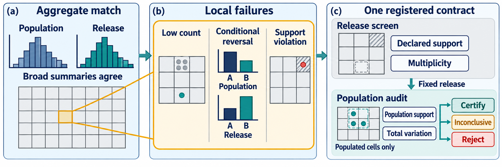
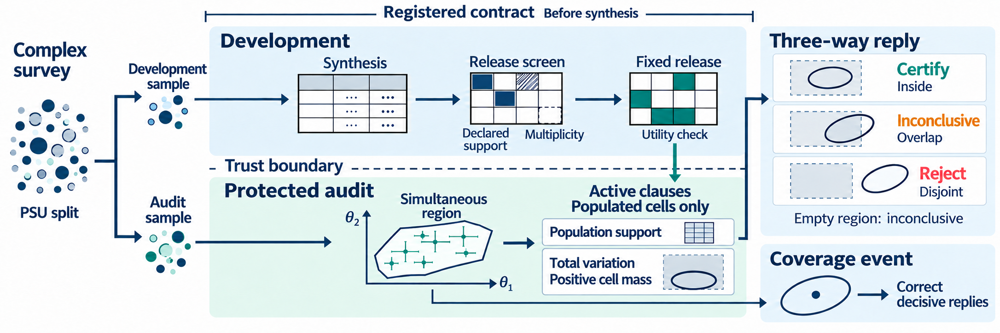
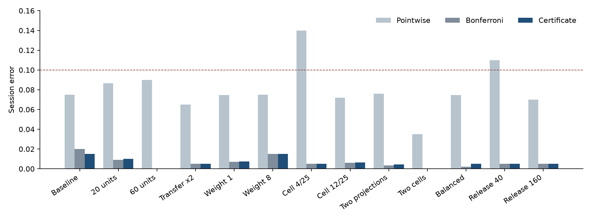

# Local Fidelity

**A synthetic table can match the margins and still invent a person who cannot exist, or a local rate the survey does not support.**

Local Fidelity certifies one released microdata table under a complex survey design. Development and audit primary sampling units are split before any fit. A deterministic screen removes declared edits and projected cells below a multiplicity floor. Every active population clause is then scored against one simultaneous replicate region built from the audit weights. The reply is certify, reject, or inconclusive.

<p align="center">
  <a href="#quick-start"><strong>Quick start</strong></a>
  &nbsp;·&nbsp;
  <a href="#reproduce-the-grid"><strong>Reproduce</strong></a>
  &nbsp;·&nbsp;
  <a href="#layout"><strong>Layout</strong></a>
</p>

## The local miss

Matching a table margin does not decide a protected cell. A release can put mass on a declared impossible combination, or move a conditional share past a registered tolerance, while the margins still look fine.

<p align="center">
  
</p>

## One region, three replies

Audit replicates form one coordinate-wise region. A clause is certified only when the whole region lies inside it, and rejected only when the region lies wholly outside it. Anything else, including an empty region, is inconclusive.

<p align="center">
  
</p>

## Session error across the design grid

Pointwise intervals lose session control when the inspection order favors narrow margins. The certificate and the Bonferroni band stay at or below the nominal level on every design below. The dashed line is that level, 0.10. A design in which every unit has the same composition is omitted: every interval collapses to the point, and every method has session error zero.

<p align="center">
  
</p>

## Quick start

Python 3.10+ recommended.

```bash
pip install -r requirements.txt
python scripts/smoke_method1.py
```

The smoke check uses a six-row synthetic release. It does not run the design grid.

## Reproduce the grid

Fourteen designs, 200 repetitions each, nominal level 0.10:

```bash
python scripts/regime_study.py
```

Four thinner designs rerun at 2000 repetitions:

```bash
python scripts/confirm_thin_regimes.py
```

Baseline only:

```bash
python scripts/ablation_method1.py
python scripts/analyze_results.py
```

Outputs go under `results/` (gitignored). Runtime is CPU-bound and grows with the repetition count.

Public-file diagnostics need three local tables, which are not bundled:

- `data/bank/bank/bank-full.csv` (UCI Bank Marketing, full file)
- `data/credit_default/credit_default.csv` (UCI default of credit card clients)
- `data/acs2024/psam_p06.csv` (2024 ACS 1-year California person file)

```bash
python scripts/case_studies.py
```

Those runs record reply mix, retained size, and runtime. They do not estimate coverage.

## Layout

```
certificate.py       screen, replicate region, three-way reply
simulate.py          finite-population designs and the study runner
scripts/             smoke check, design grid, thin-design rerun, diagnostics
docs/figures/        figures used in this README
```

## Notes

- A coordinate with standard error 0 is a point band. No numerical floor is added.
- A fidelity clause is not certified when the region still touches cell mass 0.
- A protected cell with released count 0 receives no reply.
- The utility floor is computed from the fixed release, not from the audit sample.
- Replicates resample audit primary sampling units with replacement inside each stratum and reweight each draw by the square root of \(n_h/(n_h-1)\).
